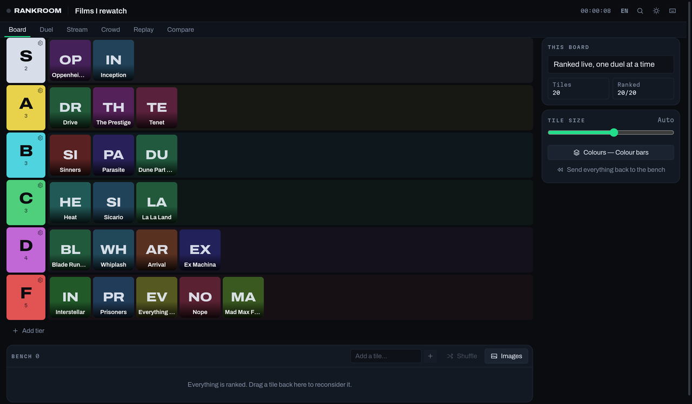
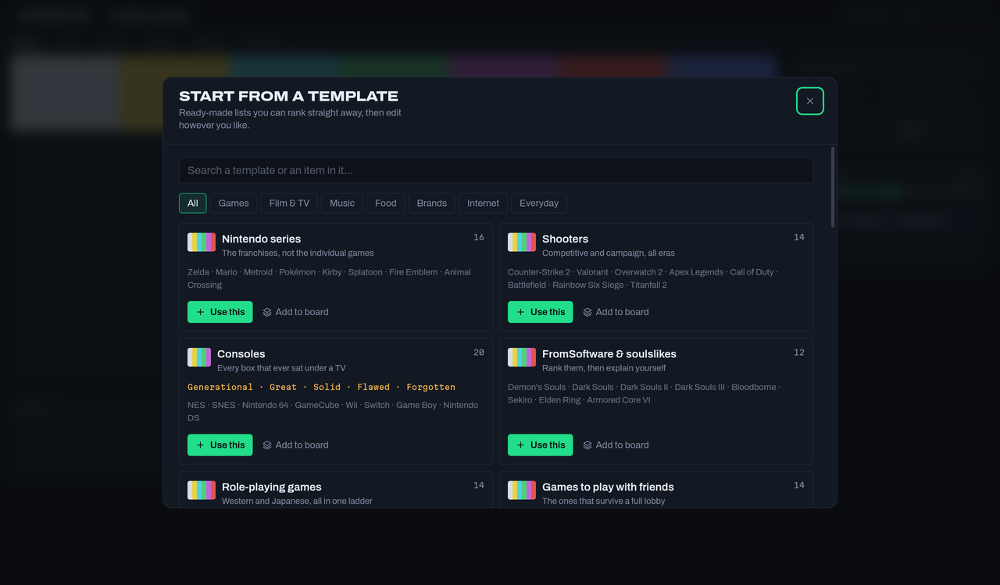
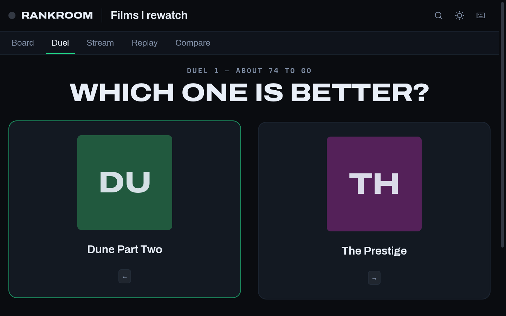
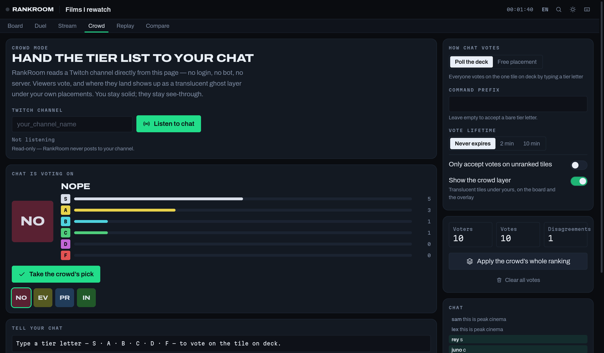
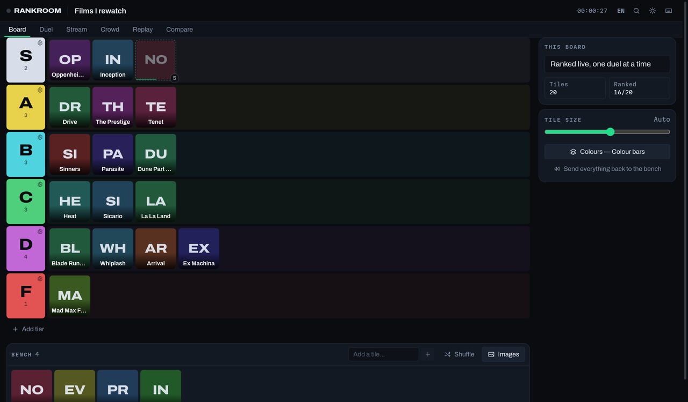
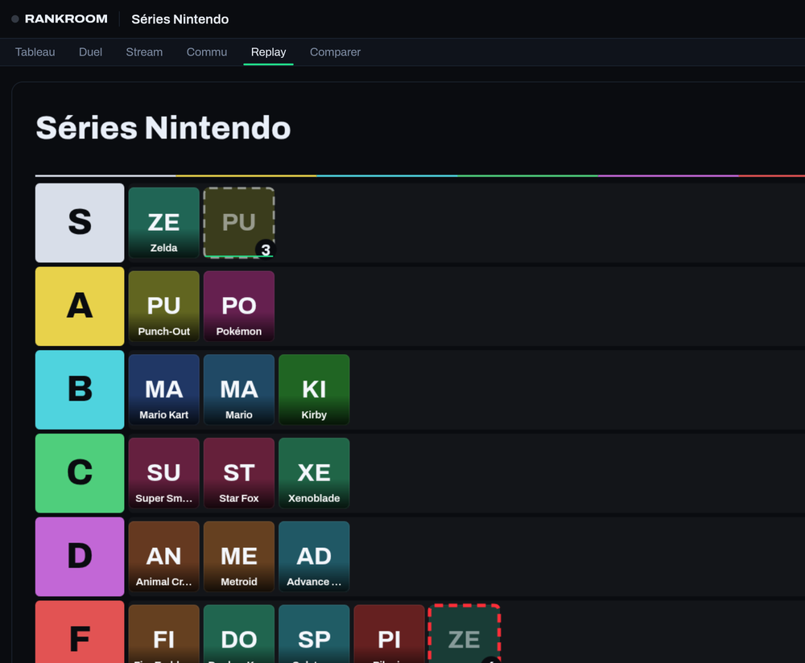
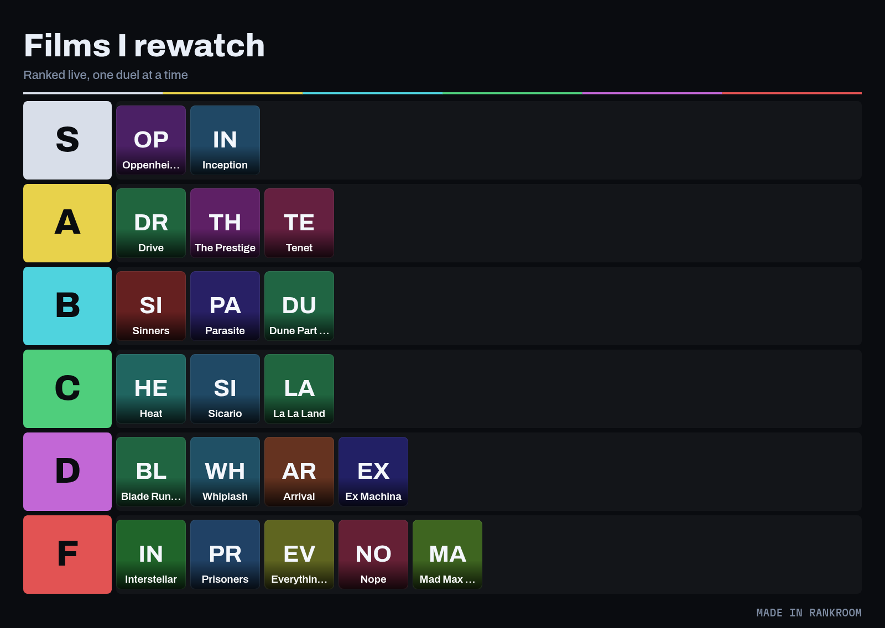
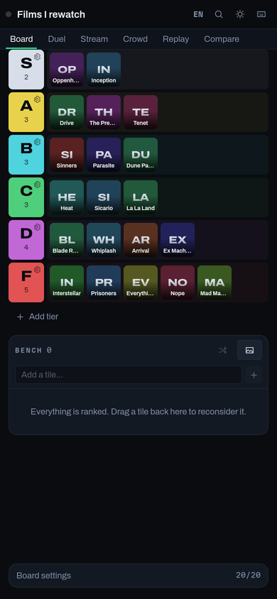

<div align="center">

<picture>
  <source media="(prefers-color-scheme: dark)" srcset="docs/media/wordmark-dark.svg" />
  
</picture>

**The ranking studio for people who publish their tier lists.**

Rank by 1v1 duels, let your Twitch chat vote, drive an OBS overlay, and export the whole
session as a video — in the browser, in English or French, with no account and no upload.

[**Open RankRoom →**](https://micferna.github.io/rankroom/)

[](https://github.com/micferna/rankroom/actions/workflows/ci.yml)
[](https://github.com/micferna/rankroom/actions/workflows/deploy.yml)
[](https://github.com/micferna/rankroom/actions/workflows/codeql.yml)
[](LICENSE)

</div>



---

## Why this exists

Tier list makers are built for _making_ a tier list. RankRoom is built for the twenty
minutes either side of that: deciding the order on camera, showing it to an audience
while it happens, and walking away with assets you can actually publish.

## Start in ten seconds

A blank board is a blank page, so RankRoom opens with a gallery of ready-made lists —
Nintendo series, shooters, consoles, Ghibli, directors, fast food, car brands, French
streamers, programming languages, days of the week. Pick one, and everything is on the
bench waiting to be ranked.



Templates carry more than a list of names: where a custom ladder says something S–F cannot,
the template brings its own. Consoles are ranked **Generational → Forgotten**, fast food
**Tonight → Never**, programming languages **By choice → Never again**.

> **On images:** templates are text tiles on purpose. Shipping logos, box art and photos of
> people would mean shipping other people's copyrighted work. Drop your own images on top
> and they replace the text.

## What it does that others don't

### ⚔️ Duel mode — rank by picking a winner

Dragging 40 tiles into the right order is a chore, and the result is usually wrong
anyway. Duel mode asks one question at a time — _A or B?_ — and binary-inserts each
item into the ranking. **20 items take about 60 duels instead of the 190 a full
round-robin needs**, and the ordering that comes out is one you actually defended.

Ties, skips and a full undo history are all one keystroke away. When the run ends you
choose the _shape_ of the ladder — even, top-heavy or bell — and the ranking drops onto
the board.



### 📺 Stream mode + an OBS overlay

One tile on deck at a time, placed with a number key, mirrored to a transparent overlay
as it happens. A tally lamp tells you when you are on air, because a tier list app
built for streamers should behave like the rest of the gear on the desk.

Two ways into the overlay, because they solve different problems:

| Link                | Where it works                                 | Live?                                                 |
| ------------------- | ---------------------------------------------- | ----------------------------------------------------- |
| `#/overlay`         | A second browser window you capture in OBS     | ✅ follows the studio in real time                    |
| `#/overlay/<board>` | Pasted straight into an OBS **Browser Source** | ❌ shows the board as it was when you copied the link |

The Browser Source runs inside OBS's own embedded browser, a separate process from your
Chrome — nothing can push state across that line without a server, and RankRoom does not
have one. The baked link is the honest answer; the window capture is the live one.

### 👥 Crowd mode — hand the tier list to your chat

RankRoom reads a Twitch channel **straight from the page**: anonymous, read-only, no bot,
no OAuth, no server. Viewers vote, and where they land shows up as a **translucent ghost
layer under your own placements** — you stay solid, they stay see-through, and the
disagreement is visible at a glance on stream.

Two ways to run it, because a live bit and a long stream want different things:

| Mode               | What chat types                     | Good for                                    |
| ------------------ | ----------------------------------- | ------------------------------------------- |
| **Poll the deck**  | just a tier letter — `S`, `a`, `!b` | A vote on camera, one tile at a time        |
| **Free placement** | `!s dune`                           | Ambient participation across a whole stream |

One vote per viewer per item, latest wins, with an optional expiry window so a poll can move
on. Ghosts only ever show a _disagreement_ — when chat agrees with you, the layer stays
quiet. And nothing chat says moves a tile on its own: you take their pick for one item, or
apply their whole ranking, on purpose.

The ghost layer renders in the OBS overlay too, so your audience watches its own votes land
next to yours.





_Above: chat put **Nope** in S with five votes, so it shows as a dashed, translucent ghost —
while the streamer's own placements stay solid._

### 🎬 Exportable replays, ending on the crowd's verdict

Every placement is logged as you make it. Replay mode plays the session back on a canvas
and records that canvas to a real video file — **16:9 for YouTube, 9:16 for Shorts,
Reels and TikTok**. The ranking assembling itself in fast-forward is the clip; you didn't
have to screen-record anything.

When chat has voted, the replay can **end on their verdict**: the ghost layer fades in over
your finished board and the single biggest disagreement is ringed in red. Below, the
streamer put Zelda in S — chat put it in F.



### 🔍 Compare two rankings

Load someone else's board — a share link or a `.json` — and RankRoom lines it up against
yours, matching by item name when the two were built separately. It scores how much you
agree, normalising across boards with different tier counts, and surfaces the **hot
takes**: the items you are furthest apart on. That list is the video.

### And the usual, done properly

- **Drag and drop** that works with a mouse, a finger, _and_ a keyboard — pick a tile up
  with <kbd>Space</kbd>, move it with the arrows, drop it with <kbd>Space</kbd>. Screen
  readers get told which tier the tile is over.
- **Drop or paste images anywhere** on the page. They are re-encoded to small WebP, which
  strips EXIF — including the GPS coordinates you did not mean to publish.
- **Export** a PNG at three sizes, a ready-made **1280×720 thumbnail** built from your top
  tier, the raw `.json`, or a `.rankroom` archive that keeps images as real files.
- **Share links carry the whole board in the URL fragment.** Fragments are never sent to a
  server, so nobody — including GitHub Pages — sees what you ranked. The link keeps working
  even if this site disappears.
- **Works offline.** A service worker precaches the app, the fonts and the icons.
- **26 built-in templates** across seven categories, searchable by name _or_ by an item
  inside them — typing "bloodborne" finds the soulslike board.
- **English and French**, detected from your browser and switchable from the header.
- **Built for a phone as much as a desktop** — tiles size themselves to the viewport, five
  per row on a 390px screen, with no hover-only controls anywhere.
- **Command palette** on <kbd>⌘</kbd><kbd>K</kbd>, undo/redo, autosave, a board shelf,
  five tier palettes, and a light theme for when the studio look is too much.

---

## The look

The default tier colours are **SMPTE colour bars** — the broadcast test card. That ramp is
ordered by descending luminance, which is exactly what a tier ladder needs: it reads
correctly at a glance, survives being screenshotted in greyscale, and every swatch clears
WCAG AA against its label. The empty board is a test pattern reading `NO SIGNAL`, and the
red and green accents are a vision mixer's program and preview buses, used with that
meaning everywhere in the app.



_The image above is a real export, produced by the same canvas renderer that draws the
replay video and the thumbnail._

---

### On a phone



Tile size follows the viewport by default — five per row at 390px, ten on a laptop — and the
slider in the inspector overrides it when you want something else. Tier controls live in a
single menu rather than a hover-revealed column, which is what let a row drop from 88px to
56px.

## Run it locally

```bash
git clone https://github.com/micferna/rankroom.git
cd rankroom
npm install
npm run dev
```

| Script                  | What it does                              |
| ----------------------- | ----------------------------------------- |
| `npm run dev`           | Vite dev server on `:5173`                |
| `npm run build`         | Type-check, then build to `dist/`         |
| `npm run preview`       | Serve the production build                |
| `npm test`              | Run the test suite                        |
| `npm run test:coverage` | …with coverage for `lib/` and `store/`    |
| `npm run lint`          | ESLint, type-aware and strict             |
| `npm run typecheck`     | `tsc --build`                             |
| `npm run format`        | Prettier                                  |
| `npm run check`         | Everything above, in the order CI runs it |
| `npm run assets`        | Regenerate the icons and social card      |

Node 20.19+ is required. There is no backend, no database, and no environment file.

## Deploy your own

The app is a static bundle, so anything that serves files will host it.

- **GitHub Pages** — push to `main` and [`deploy.yml`](.github/workflows/deploy.yml) does it.
  Set _Settings → Pages → Source_ to **GitHub Actions** once.
- **Anywhere else** — `BASE_PATH=/ npm run build` and upload `dist/`.

`BASE_PATH` must match the subdirectory the app is served from, with a trailing slash.

---

## How it is built

React 19 · TypeScript 5.9 (strict, `noUncheckedIndexedAccess`) · Vite 8 · Tailwind CSS 4 ·
zustand · dnd-kit. Three runtime dependencies beyond React itself.

Everything that could be a dependency but did not need to be is not one: the icon set, the
canvas renderer, the service worker, the share-link codec, the i18n layer, the Twitch chat
client and the icon generator are all first-party and dependency-free. `npm audit` reports
zero vulnerabilities.

The domain logic — placement, tier maths, the duel engine, the vote tally, the templates,
the share codec, the untrusted-input parser — is pure and lives in [`src/lib/`](src/lib),
covered by 137 tests and importable without a DOM. React components read it; they do not
reimplement it.

📐 **[docs/ARCHITECTURE.md](docs/ARCHITECTURE.md)** walks through the data model, the undo
system, the replay pipeline and the security boundaries.

## Contributing

Issues and pull requests are welcome — see [CONTRIBUTING.md](CONTRIBUTING.md). Found a
security issue? [SECURITY.md](SECURITY.md) explains where to send it.

## Licence

[MIT](LICENSE). The bundled fonts are [SIL OFL 1.1](public/fonts/LICENSE.md).
